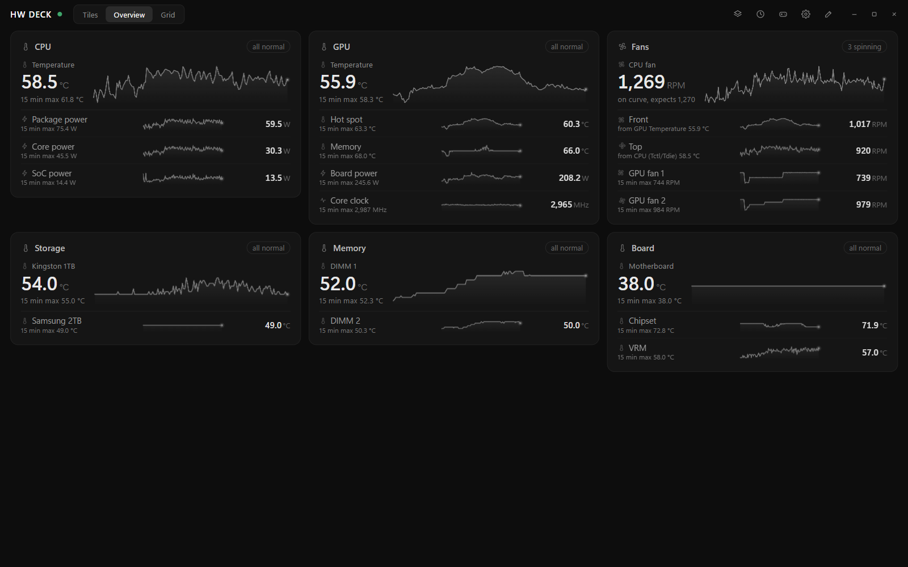
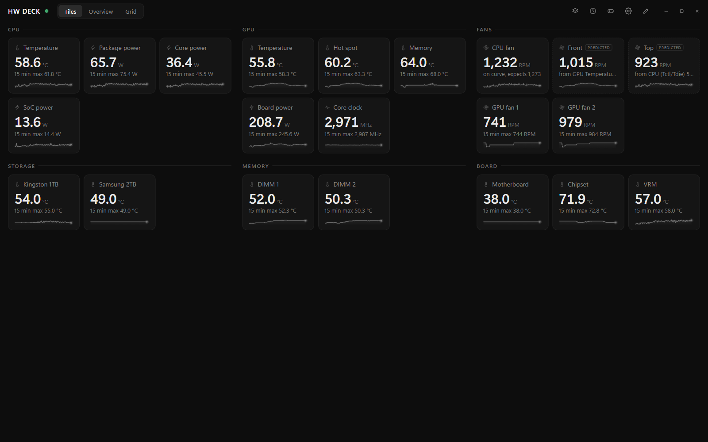
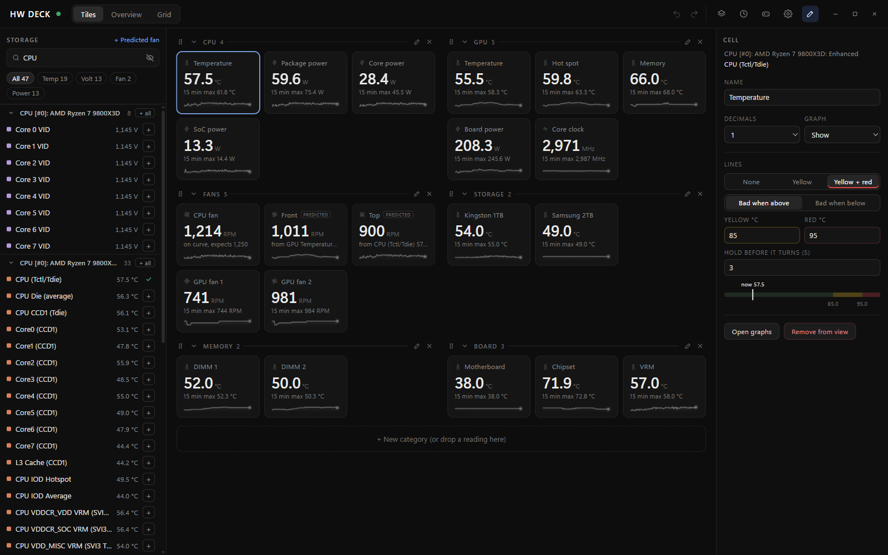
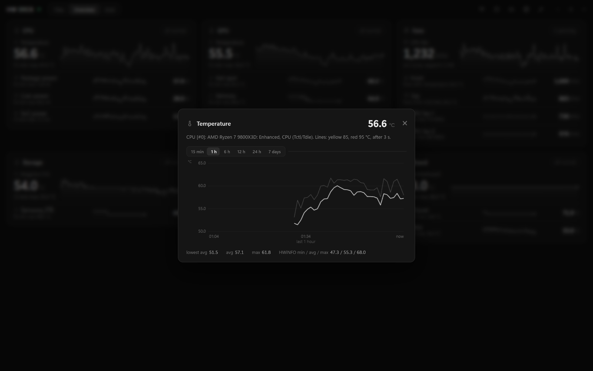
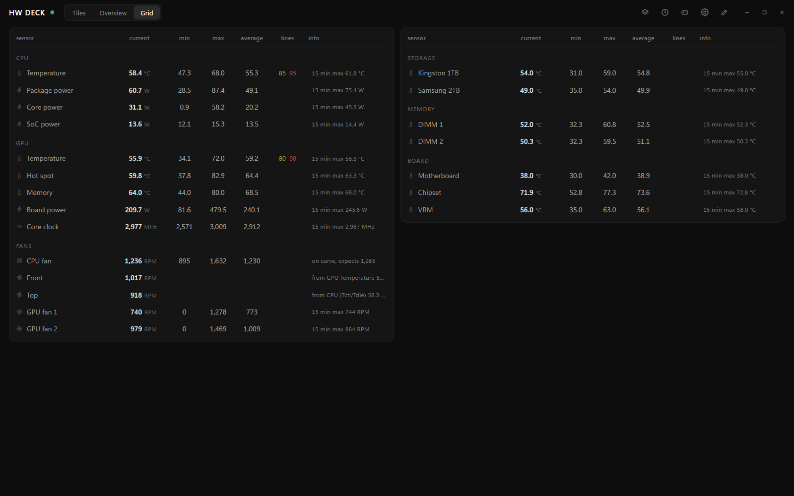

# HW Deck

A small dashboard for HWiNFO. Pick the sensors you care about, give them warning lines, and it keeps an eye on them, even from the tray.



## Setup

1. Install [HWiNFO](https://www.hwinfo.com) and turn on Shared Memory Support in its settings.
2. Download the zip from [Releases](https://github.com/RodrigoArsenioo/hwdeck/releases/latest) and unzip it anywhere.
3. Run `HWDeck.exe`. The first time, Windows warns you because the app isn't signed: click More info, then Run anyway.

Works on 64-bit Windows 10 and 11.

## Using it

- Drag sensors from the list on the left into your view, or press + on one.
- Click a cell to see its graph, up to 7 days back.
- In edit mode (the pencil, or E) you can set yellow and red lines on a cell, or a curve on a fan.
- Tiles, Overview and Grid are three ways to look at the same cells (keys 1, 2, 3).
- Closing the window keeps it in the tray, still watching. Right-click the tray icon to quit.
- The clock icon lists past warnings, the gamepad icon your game sessions.

The free HWiNFO stops sharing after 12 hours. HW Deck then shows a button to restart it.

| | |
|---|---|
|  |  |
|  |  |

## Good to know

- Nothing leaves your PC. No account, no tracking.
- Your layouts and history are in `%APPDATA%\HW Deck`.
- Not made by or affiliated with HWiNFO.

## Building it

```
powershell -ExecutionPolicy Bypass -File scripts\fetch-deps.ps1
powershell -ExecutionPolicy Bypass -File scripts\build.ps1
```

More in [docs/DEVELOPING.md](docs/DEVELOPING.md). License: MIT.
