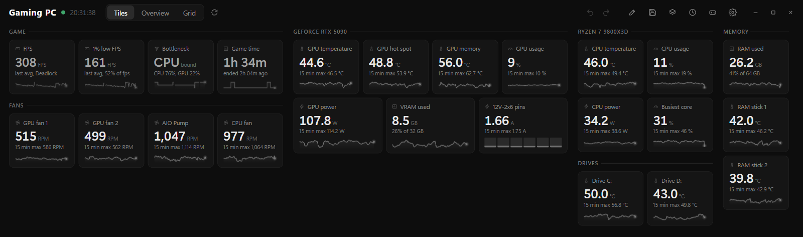

# HW Deck

A small dashboard for HWiNFO. Pick your sensors, give them warning lines, and it keeps an eye on them, even from the tray.

**[Try it in your browser](https://rodrigoarsenioo.github.io/hwdeck/)**, nothing to install.



## Install

1. Install [HWiNFO](https://www.hwinfo.com), start it with **Sensors-only**, and in its settings tick **Shared Memory Support**.
2. Paste this into PowerShell:

   ```
   irm https://raw.githubusercontent.com/RodrigoArsenioo/hwdeck/main/install.ps1 | iex
   ```

   Or run the `.msi` from [Releases](https://github.com/RodrigoArsenioo/hwdeck/releases/latest). Windows warns because it isn't signed: More info, then Run anyway.

Windows 10 and 11, 64-bit.

## Use

- It starts with a layout made from your PC's sensors. Press **E** to change it.
- Click a cell to see its graph. Select one to give it warning lines.
- The clock shows past warnings, the gamepad your game sessions.
- Settings has the rest.

## Good to know

- The free HWiNFO stops sharing after 12 hours. Turn on **Keep HWiNFO sharing** in Settings and HW Deck restarts it for you.
- No account, no tracking. It only contacts GitHub for updates, and Cloudflare for the speed test once you turn it on (LibreSpeed when Cloudflare refuses).
- Your data is in `%APPDATA%\HW Deck`.
- Not made by or affiliated with HWiNFO.

## Build

```
powershell -ExecutionPolicy Bypass -File scripts\fetch-deps.ps1
powershell -ExecutionPolicy Bypass -File scripts\build.ps1
```

More in [docs/DEVELOPING.md](docs/DEVELOPING.md). License: MIT.
